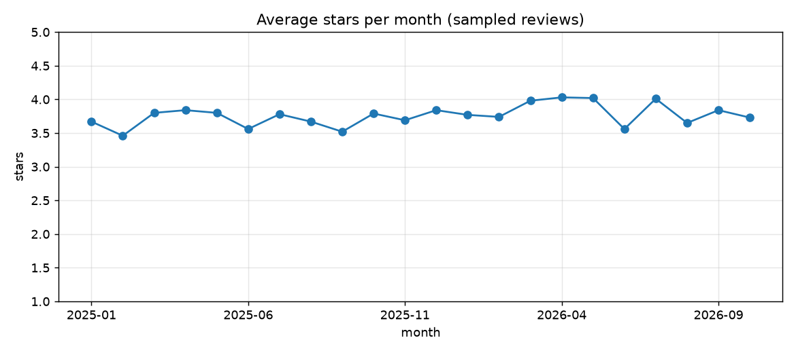
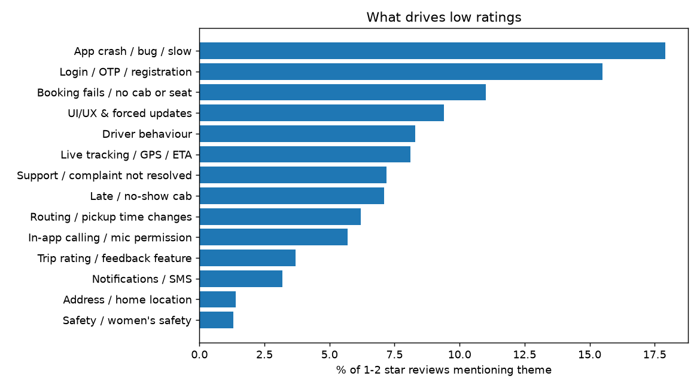

# Play Store rating report - 2026-10-12

App: `com.moveinsync.ets` | Reviews analysed: 5000 (2025-01-22 to 2026-10-11)

## Headline

- Sample average: **3.77** stars; **28%** of reviews are 1-2 stars.
- Last 90 days: **3.81** (721 reviews) vs previous 90 days: 3.82.
- Developer reply rate: **3%** of reviews.
- Star distribution: 1*: 1248, 2*: 165, 3*: 145, 4*: 381, 5*: 3061

## Why the rating is low: themes ranked by estimated rating lift if fixed

`Rating lift` = how much the average would rise if every 1-2 star review about that theme had been 4 stars. A reviewer can mention several themes, so lifts overlap and are not additive.

| Theme | Owner | Reviews | % of all | Low-star (1-2) reviews | % of low-star | Avg stars when mentioned | Rating lift if fixed (est.) |
|---|---|---|---|---|---|---|---|
| App crash / bug / slow | Engineering | 332 | 6.6 | 253 | 17.9 | 1.8 | 0.144 |
| Login / OTP / registration | Engineering | 261 | 5.2 | 219 | 15.5 | 1.55 | 0.126 |
| Booking fails / no cab or seat | Product + Eng | 255 | 5.1 | 156 | 11.0 | 2.42 | 0.089 |
| UI/UX & forced updates | Product | 359 | 7.2 | 133 | 9.4 | 3.35 | 0.076 |
| Driver behaviour | Operations | 219 | 4.4 | 117 | 8.3 | 2.65 | 0.068 |
| Live tracking / GPS / ETA | Engineering | 264 | 5.3 | 114 | 8.1 | 3.08 | 0.065 |
| Support / complaint not resolved | Ops / Support | 114 | 2.3 | 102 | 7.2 | 1.47 | 0.06 |
| Late / no-show cab | Operations | 127 | 2.5 | 100 | 7.1 | 1.79 | 0.057 |
| Routing / pickup time changes | Ops / Routing | 118 | 2.4 | 87 | 6.2 | 1.97 | 0.051 |
| In-app calling / mic permission | Engineering | 113 | 2.3 | 80 | 5.7 | 1.96 | 0.046 |
| Trip rating / feedback feature | Product | 63 | 1.3 | 52 | 3.7 | 1.62 | 0.03 |
| Notifications / SMS | Engineering | 66 | 1.3 | 45 | 3.2 | 2.15 | 0.026 |
| Address / home location | Product | 27 | 0.5 | 20 | 1.4 | 1.85 | 0.012 |
| Safety / women's safety | Ops + Product | 80 | 1.6 | 18 | 1.3 | 4.04 | 0.011 |

## Example low-star reviews per top theme

**App crash / bug / slow**
- "The app frequently crashes or hangs while booking cabs, which makes it really frustrating, especially when I’m in a hurry. The GPS tracking is unreliable—it often shows t"
- "app works fine. But... the app leaves a lot to be desired. yeah, it works fine but things like what to do when you're stuck...the error messages are confusing, you look a"

**Login / OTP / registration**
- "It has been a frustrating experience not only to me but all of my team mates since the last update. I log in and first time it logs in to the app correctly. But after som"
- "I have been using this app for years and was getting a feedback rate option till 2024 without any issues. I don't know what developers did, but from a few months I am not"

**Booking fails / no cab or seat**
- "The app frequently crashes or hangs while booking cabs, which makes it really frustrating, especially when I’m in a hurry. The GPS tracking is unreliable—it often shows t"
- "Do you even read the comments ??? Or just Blabber !!!! On multiple occasions i have observed that the app while booking a parking slot will always show waiting for me but"

**UI/UX & forced updates**
- "It has been a frustrating experience not only to me but all of my team mates since the last update. I log in and first time it logs in to the app correctly. But after som"
- "app works fine. But... the app leaves a lot to be desired. yeah, it works fine but things like what to do when you're stuck...the error messages are confusing, you look a"

**Driver behaviour**
- "The app frequently crashes or hangs while booking cabs, which makes it really frustrating, especially when I’m in a hurry. The GPS tracking is unreliable—it often shows t"
- "Could not call the bus driver at critical time, as if I click on the call button, it says like The company policy is not allowed to call. Because of this functionality, I"

**Live tracking / GPS / ETA**
- "The app frequently crashes or hangs while booking cabs, which makes it really frustrating, especially when I’m in a hurry. The GPS tracking is unreliable—it often shows t"
- "It has been a frustrating experience not only to me but all of my team mates since the last update. I log in and first time it logs in to the app correctly. But after som"

## Same table for the last 90 days only (what is hurting NOW)

| Theme | Owner | Reviews | % of all | Low-star (1-2) reviews | % of low-star | Avg stars when mentioned | Rating lift if fixed (est.) |
|---|---|---|---|---|---|---|---|
| App crash / bug / slow | Engineering | 50 | 6.9 | 37 | 18.0 | 1.86 | 0.147 |
| Booking fails / no cab or seat | Product + Eng | 40 | 5.5 | 28 | 13.7 | 2.17 | 0.108 |
| Login / OTP / registration | Engineering | 30 | 4.2 | 23 | 11.2 | 1.83 | 0.092 |
| Late / no-show cab | Operations | 22 | 3.1 | 19 | 9.3 | 1.64 | 0.075 |
| UI/UX & forced updates | Product | 39 | 5.4 | 19 | 9.3 | 2.92 | 0.075 |
| Support / complaint not resolved | Ops / Support | 22 | 3.1 | 18 | 8.8 | 1.82 | 0.072 |
| Routing / pickup time changes | Ops / Routing | 23 | 3.2 | 15 | 7.3 | 2.3 | 0.061 |
| Live tracking / GPS / ETA | Engineering | 26 | 3.6 | 14 | 6.8 | 2.77 | 0.055 |
| Driver behaviour | Operations | 20 | 2.8 | 9 | 4.4 | 3.05 | 0.037 |
| In-app calling / mic permission | Engineering | 10 | 1.4 | 9 | 4.4 | 1.3 | 0.037 |
| Trip rating / feedback feature | Product | 11 | 1.5 | 9 | 4.4 | 1.64 | 0.036 |
| Notifications / SMS | Engineering | 11 | 1.5 | 8 | 3.9 | 2.18 | 0.029 |
| Safety / women's safety | Ops + Product | 16 | 2.2 | 3 | 1.5 | 4.31 | 0.011 |
| Address / home location | Product | 4 | 0.6 | 3 | 1.5 | 2.5 | 0.01 |

## Worst app versions (min review count applied)

| App version | Avg stars | Reviews |
|---|---|---|
| 12.1.2 | 3.57 | 258 |
| 12.4 | 3.59 | 140 |
| 12.19.0 | 3.61 | 104 |
| 11.5.17 | 3.62 | 288 |
| 12.7.2 | 3.62 | 93 |
| 12.3 | 3.63 | 152 |
| 12.13.1 | 3.68 | 95 |
| 12.8.3 | 3.68 | 105 |
| 12.9.4 | 3.7 | 81 |
| 11.5.20 | 3.71 | 99 |

## Monthly trend

| Month | Avg stars | Reviews |
|---|---|---|
| 2025-01 | 3.67 | 88 |
| 2025-02 | 3.46 | 229 |
| 2025-03 | 3.8 | 226 |
| 2025-04 | 3.84 | 228 |
| 2025-05 | 3.8 | 257 |
| 2025-06 | 3.56 | 301 |
| 2025-07 | 3.78 | 293 |
| 2025-08 | 3.67 | 240 |
| 2025-09 | 3.52 | 205 |
| 2025-10 | 3.79 | 297 |
| 2025-11 | 3.69 | 160 |
| 2025-12 | 3.84 | 196 |
| 2026-01 | 3.77 | 211 |
| 2026-02 | 3.74 | 207 |
| 2026-03 | 3.98 | 197 |
| 2026-04 | 4.03 | 292 |
| 2026-05 | 4.02 | 247 |
| 2026-06 | 3.56 | 273 |
| 2026-07 | 4.01 | 285 |
| 2026-08 | 3.65 | 242 |
| 2026-09 | 3.84 | 245 |
| 2026-10 | 3.73 | 81 |

## Method and limits
- Reviews pulled with google-play-scraper (newest first). Themes are tagged with keyword rules (multi-label); validate on a manual sample and tune `THEMES`.
- Reviews are self-selected and the sample may differ from the official all-time score.
- `no_theme` reviews (mostly short praise or vague text) are not counted in any theme.
